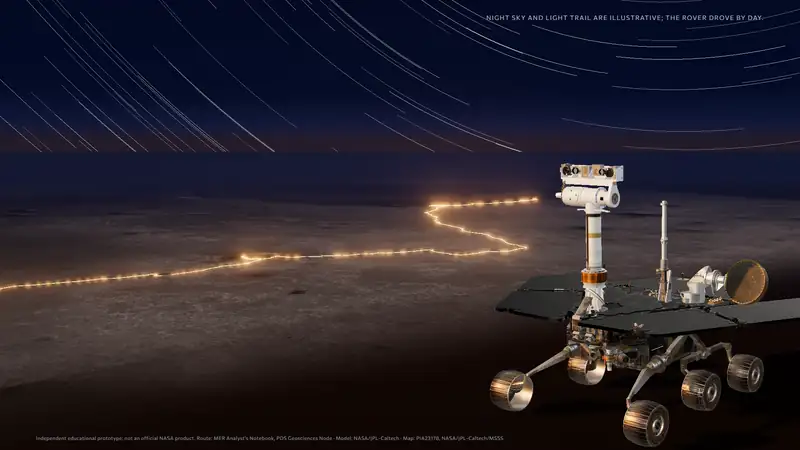

# Echoes of the Cosmos

**Built for 90 sols. It kept going for 5,111.**

<p align="center">
  <a href="https://echoes-of-the-cosmos-2026.vercel.app/film/echoes-of-the-cosmos-30s.mp4">
    
  </a>
</p>

<p align="center">
  <a href="https://echoes-of-the-cosmos-2026.vercel.app/film/echoes-of-the-cosmos-30s.mp4"><b>Watch the 30-second film</b></a>
  (English voice-over and captions) ·
  <a href="public/film/echoes-of-the-cosmos-30s.mp4">mp4 in this repo</a> ·
  <a href="film/captions.srt">captions (.srt)</a>
</p>

<p align="center"><sub>The preview above is silent; the film has sound. The voice is synthetic (see <a href="docs/AI_DISCLOSURE.md">AI disclosure</a>).</sub></p>

An educational, story-driven web replay of NASA's Opportunity rover, made for the NASA Space Apps Challenge 2026
challenge *Abandoned but not Forgotten: Storytelling about NASA's Discarded Equipment on the Moon and Mars*.

- Live site: https://echoes-of-the-cosmos-2026.vercel.app
- The rover, part by part: https://echoes-of-the-cosmos-2026.vercel.app/rover
- How this was made (method, gaps, credits, sources): https://echoes-of-the-cosmos-2026.vercel.app/about
- 30-second film: rendered from https://echoes-of-the-cosmos-2026.vercel.app/film

Independent educational prototype; not an official NASA product and not endorsed by NASA.

## The problem

Opportunity landed on Mars in January 2004, was designed for 90 Martian days, and kept working for more than 14 years.
Since June 2018 it has sat silent in Perseverance Valley. It is one of the "inactive monuments" the challenge asks us
to remember. Most of what a student can find about it is either a static map or an article. Neither lets them watch
where a discovery happened, or see which part of the rover made it.

## The solution

The whole mission is shown as one long night exposure. The rover's real recorded route is drawn as a warm light trail
across NASA's orbital map of Meridiani Planum, and NASA's own 3D model of the rover stands in the foreground.

- **The journey:** 8 stops in 4 chapters (Arrival, Stuck, Better water, Silence). Each stop asks a question a 12–17
  year-old would ask ("What happens when a rover gets stuck?"), answers it in one line, and opens a "developed print":
  the NASA image, the evidence, a quote, what the evidence does *not* tell us, 3 FAQs and the sources.
- **Tool → discovery:** at 6 stops a light-paint reveal picks out the part that did the work (the arm's RAT, then
  APXS, at Esperance; the wheels at Purgatory; the solar arrays at Silence).
- **Silence and Legacy:** an illustrative dust storm, the two real dates (last position record sol 5081, last
  message sol 5111), then the camera rises over the whole exposure and sets what NASA wanted to know next to what
  Opportunity helped reveal, row by row, each with a source.
- **/rover:** the six parts of the rover, keyboard-operable, with deep links (`/rover#rat`) and "See it at Stop n".
- **Equal paths:** a Static view with the same content (no WebGL, low-end devices), a visible Reduce motion toggle,
  keyboard control (← → Space Home Esc), WCAG 2.2 AA (axe-core: 0 violations on 8 views at 1440 and 390 px).

## How NASA data is used

| Data | Source | How it is used |
|---|---|---|
| Rover positions (21,104 rows, sols 1–5081) | MER Opportunity traverse table `MERB_traverse_5130`, MER Analyst's Notebook, PDS Geosciences Node (WUSTL); traverse by Tim Parker | Python ETL → the light trail, the live sol / km readout, the gaps |
| Orbital map | NASA PIA23178, *Opportunity's Final Traverse Map* (NASA/JPL-Caltech/MSSS) | The ground, aligned by a 2-point fit |
| Rover 3D model | NASA *Spirit and Opportunity Rover 3D Model* (NASA/JPL-Caltech) | The rover, split by its material groups into 6 parts |
| Images | 8 NASA/JPL photojournal images (PIA05755, PIA05634, PIA07999, PIA08813, PIA14509, PIA17074, PIA22929, PIA23178) | The evidence prints, each with its own credit |
| Facts and quotes | 31 NASA, JPL and NSSDCA pages (NSSDCA 2003-032A, MER Science Instruments and Science Objectives, JPL news releases, image captions) | Every claim on the site links to its source; all were re-opened on 14 Nov 2026 |

Details: [docs/DATA_METHODOLOGY.md](docs/DATA_METHODOLOGY.md) · Credits: [docs/CREDITS.md](docs/CREDITS.md) ·
AI use: [docs/AI_DISCLOSURE.md](docs/AI_DISCLOSURE.md)

## Architecture

```
data/raw/MERB_traverse_5130.{csv,lbl}  --scripts/transform_traverse.py-->  public/data/traverse.json (+ route, manifest)
                                                                           |
Vite + React + TypeScript (text layer, routes /, /rover, /about, /film)    |
  └── vanilla three.js stage, one render(state) per frame  <---------------┘
        src/engine/replay.ts     hold-then-move replay of the records (unit-tested)
        src/stage/director.ts    camera shots per stop, pure stateAt(transition, time)
        src/stage/lightpaint.ts  the part reveal, a pure function of (selection, time)
        src/film/script.ts       the 30 s film as a pure function of t (window.seek)
  content: src/content/*.json (events, FAQ, parts, legacy, media, sources), linted by scripts/lint_content.mjs
```

## Run it

```bash
npm install
npm run dev                 # http://localhost:5173
npm test                    # vitest: replay engine, light-paint, /about numbers (22 tests)
node scripts/lint_content.mjs        # content lint: banned phrases, word counts, every source and part exists
python -P scripts/transform_traverse.py   # rebuild public/data from the raw CSV (pytest: tests/test_transform.py)
npm run build && npm run preview
```

Film: `npm run build && npx vite preview --port 5181`, then
`PLAYWRIGHT=<playwright path> node scripts/capture_film.mjs` (frame-by-frame, 60 fps), the score with
`python <teardown skill>/run_sfx.py film/score.py`, and the English voice-over and captions with
`KOKORO_DIR=<model folder> python film/narrate.py` (synthetic voice, Kokoro-82M; see docs/AI_DISCLOSURE.md).
`film/captions.srt` can be uploaded to YouTube as the caption track.

## Limitations

- The traverse table is **not a formally archived PDS product** (its label says so). Coordinates are local
  easting/northing in metres; the unit is inferred, not stated.
- It gives one position per drive, not per moment. Between records the rover moves in a straight line, labelled
  "Between two records"; it never moves through the 6 gaps in the records.
- The route is pinned to NASA's map at its first and last records, so elsewhere it can sit up to about 0.5 km off.
- The ground is flat (no elevation data), the rover on the map is not to scale, and the night sky, light trail,
  dust storm and rover lighting are illustrative. The rover drove by day. Each of these is labelled on screen.
- English only.

## How this was built

Built solo during the hackathon (14–15 Nov 2026). Research and planning done before the event (source checks, data
report, design brief) are public in a separate repository,
[echoes-of-the-cosmos-research](https://github.com/hoanganh-repogit/echoes-of-the-cosmos-research), with the build log;
it contains no product code. All code here was written during the hackathon. AI assistance is described in [docs/AI_DISCLOSURE.md](docs/AI_DISCLOSURE.md).
